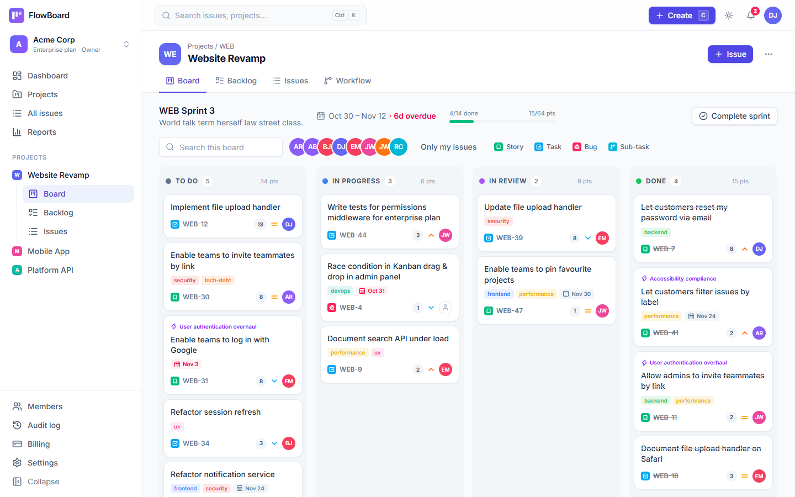
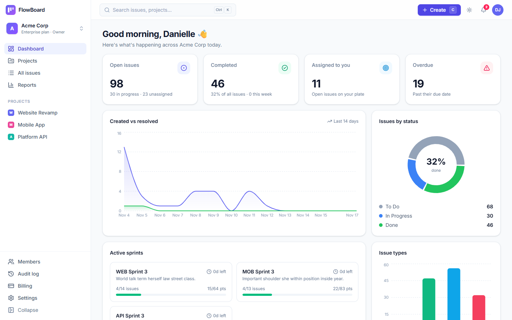
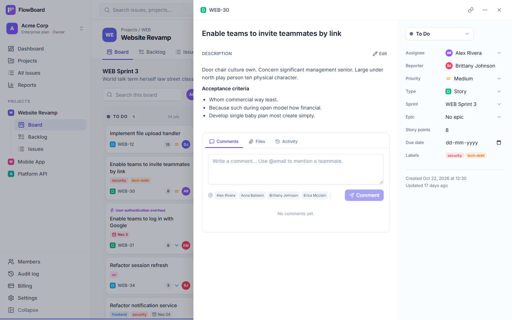
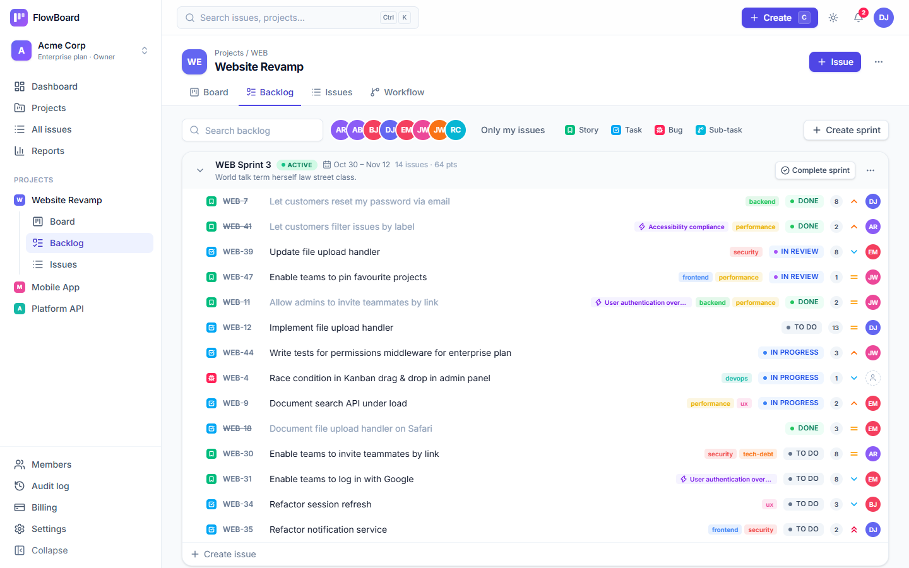
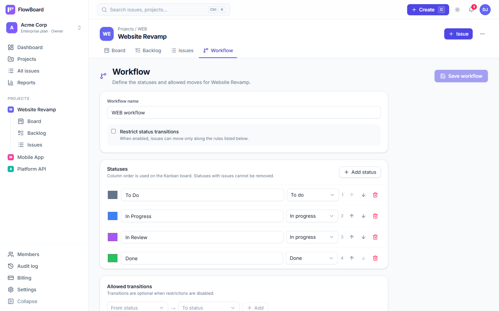
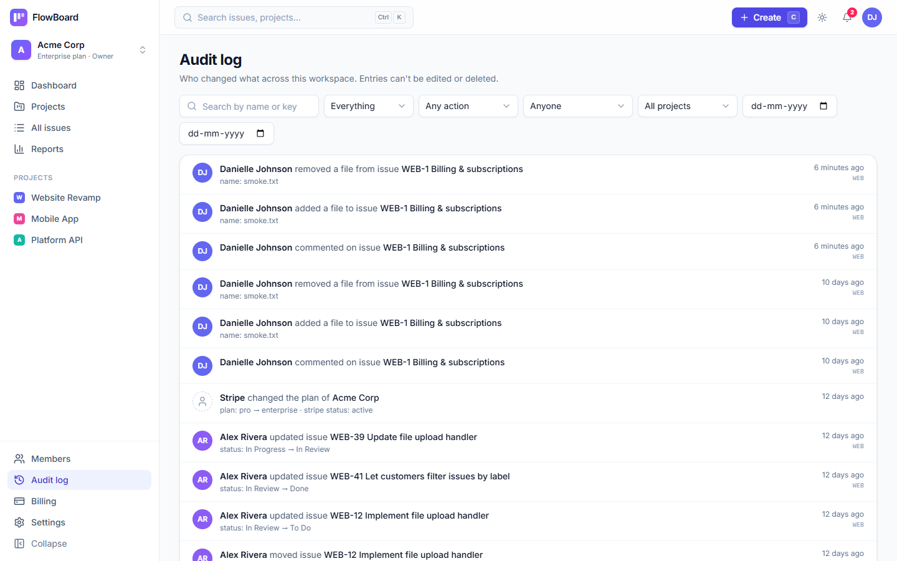
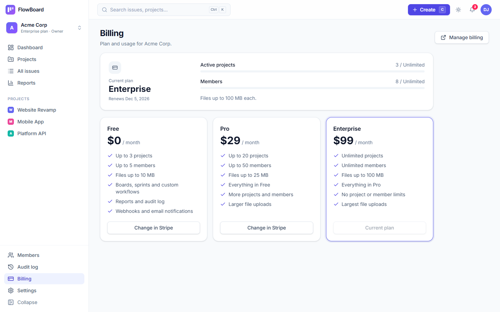
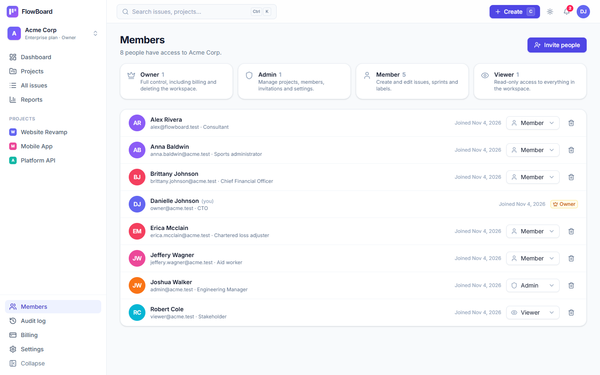
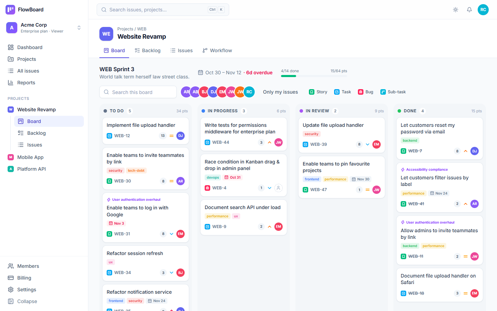
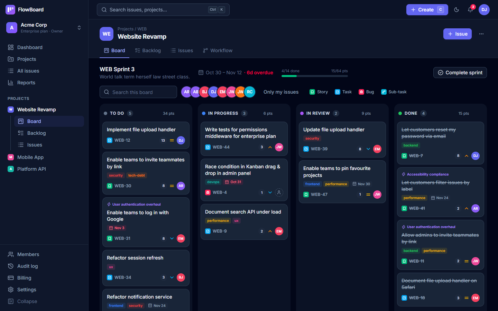

# FlowBoard: multi-tenant project management SaaS

A Jira-like platform where every company gets its own isolated workspace with projects, Kanban and
scrum boards, sprints, custom workflows and billing.

**Stack:** Django REST Framework · React 19 + TypeScript (Vite, pnpm) · PostgreSQL · Celery + Redis ·
Stripe Billing · pytest + Vitest · Docker · GitHub Actions

| 📄 Doc | What's inside |
|---|---|
| **README.md** (this file) | What it is, how to run it (Docker or local), demo accounts, project status |
| [docs/ARCHITECTURE.md](docs/ARCHITECTURE.md) | System design, multi-tenancy, data model, auth & roles, billing, frontend, Docker and CI/CD |
| [docs/API_TEST.md](docs/API_TEST.md) | Testing the API with Swagger / curl / PowerShell, endpoint reference, security scenarios, automated tests |
| [docs/TEST_RESULTS.md](docs/TEST_RESULTS.md) | Test results (983 backend, 47 frontend, 26/26 smoke, 33/33 nginx security) and measured API response times |
| [docs/DEMO.md](docs/DEMO.md) | Step-by-step demo script with accounts, timings and fallbacks |
| [docs/PRESENTATION.md](docs/PRESENTATION.md) | 10-minute presentation outline: problem, design, challenges, results, next steps |
| [docs/REFLECTION.md](docs/REFLECTION.md) | Individual reflection (draft to personalise) |

---

## Build progress

| Phase | Scope | Status |
|---|---|---|
| 1 | Tenant isolation strategy + data models + Faker seed data | ✅ done |
| 2 | REST API (DRF) + JWT auth + role permissions | ✅ done |
| 3 | React UI + drag-and-drop Kanban | ✅ done |
| 4 | Custom workflows, comments, attachments, audit log | ✅ done |
| 5 | Webhooks + Celery background jobs (notifications, reports, email) | ✅ done |
| 6 | Stripe Billing (test mode) + plan limits | ✅ done |
| 7 | Docker images + GitHub Actions CI/CD | ✅ done |
| + | API hardening review (88 endpoints) and schema review (all 21 tables) | ✅ done |
| + | Security hardening: production config, httpOnly refresh cookie, token cleanup, security audit | ✅ done |

## Features

**Public home page**
- Visitors land on a product page at `/`: hero with a live-looking board preview, features, how multi-tenancy
  works, roles, a 4-step "how it works", pricing for the three plans, the tech stack and an FAQ.
- Responsive, light/dark aware, with **Start for free** (sign-up) and **Try the live demo** (login with demo
  accounts). Signed-in users skip it and go straight to their last workspace.

**Multi-tenancy & security**
- Every company is an isolated **workspace**. Data is separated with a `workspace_id` on every row,
  enforced at the request, query and write layers ([details](docs/ARCHITECTURE.md#4-multi-tenancy)).
- Other tenants' data is invisible: their workspaces and records return **404**, and foreign ids in
  payloads are rejected.
- **JWT** auth with rotating refresh tokens, logout (one session or all), forgot/reset password, and a password
  change that signs out every other session. In the browser the refresh token lives only in an **httpOnly,
  SameSite=Strict cookie** and the access token only in memory, so page scripts can't read either from storage;
  tabs coordinate refreshes with Web Locks. Expired tokens are cleaned up nightly.
- **Production hardening**: Django admin limited to an IP allowlist, strict Content-Security-Policy and security
  headers, HTTPS redirect and HSTS, API docs and CORS off by default in production, and reset/invite tokens
  redacted from the nginx and Django logs ([details](docs/ARCHITECTURE.md#72-security-hardening-production-configuration-and-logging)).
- **Rate limits** on every sensitive endpoint, plus a per-account login lockout shared by the API and the Django
  admin. Counters live in Redis, so they hold across all API processes.
- **Roles**: owner › admin › member › viewer. Only the owner manages admins; ownership moves through an explicit
  transfer. The UI mirrors what each role can do, and the API enforces it in services, not just views.
- Invitations by email or link (7-day expiry, one open invite per email), and one user can belong to several
  workspaces.
- Destructive deletes need confirmation (project key; workspace slug + password), and concurrent requests are
  serialised with row and advisory locks backed by database constraints, so races return a clean 400, not a 500.
  Deleting a workspace hides it at once and removes its data in the background in short batches, so even a very
  large workspace can be deleted without request timeouts.
- **Integrity in the database**: every rule a bulk write, the admin or raw SQL could break is a PostgreSQL CHECK,
  unique index, composite foreign key or trigger (all 21 tables reviewed), and every edit saves only the fields it
  changed after re-reading the row under a lock, so concurrent writers never undo each other.

**Project management**
- Projects with keys (`WEB`), per-project workflows (To Do → In Progress → In Review → Done) and boards.
- **Drag-and-drop Kanban**: move across and within columns; the card moves instantly and snaps back if
  the server rejects the move. Also WIP limits, quick-add and filters.
- **Backlog & sprints**: drag issues between sprints and the backlog; plan, start and complete sprints
  (unfinished work carries over).
- Issues: epics, stories, tasks, bugs, sub-tasks, priorities, story points, due dates, labels, markdown
  descriptions, and keys like `WEB-12`.
- **Issue drawer** with inline editing, and a deep link for every issue (`?issue=WEB-12`).
- **Dashboard**: KPIs, created-vs-resolved trend, status and type charts, sprint progress, team workload.
- Issues table across projects with search, filters, sorting and pagination.
- `Ctrl/⌘ K` command palette, `C` to create an issue, light/dark/system theme, responsive layout.

**Collaboration & workflows**
- **Workflow editor**: custom statuses and allowed transitions per project. The board dims columns a card can't
  move to, and the API enforces the rules.
- **Comments** with `@email` mentions (only the author edits a comment), **file attachments** (checked by their
  actual bytes, plan-sized up to 100 MB, private downloads), and an activity history on every issue.
- Archived projects are read-only everywhere until restored.
- **Audit log** (admins): filterable, workspace-wide history of issue, project, sprint, workflow, member,
  invitation, label, webhook and workspace changes.

**Automation**
- **Webhooks**: timestamped HMAC signatures (replay-safe), a signing secret shown only once, smart retries
  (5xx/429/network only), auto-disable after 20 failures, redelivery, delivery history and a test button. Outbound
  requests are SSRF-safe: public HTTPS targets only, pinned IPs, no redirects, hard time limits.
- **Notifications**: in-app bell, plus email for mentions, new assignments, overdue issues and a daily digest
  (users can opt out).
- **Reports**: sprint burndown, velocity and workspace summary, generated in the background and exported as CSV.
  Identical pending requests are merged.
- A nightly retention job trims old deliveries, notifications, reports and Stripe events.

**Billing (Stripe, test mode)**
- Three plans: **Free**, **Pro** ($29/mo) and **Enterprise** ($99/mo), each with its own project, member and
  file-size limits (see [Plans](#plans)).
- Owners upgrade through **Stripe Checkout** and manage cards, invoices and cancellation in the **Customer
  Portal**. Card details never touch FlowBoard.
- Signed **Stripe webhooks** (processed once each) keep the plan in sync; a **Sync** call reads the state
  straight from Stripe when webhooks can't reach the machine.
- Double-charge protection: one open checkout per workspace (advisory lock + Stripe idempotency keys), and a
  second live subscription is cancelled automatically and flagged for a manual refund review.
- Hitting a limit returns **HTTP 402** and the UI offers an upgrade. Limits only block adding more: a
  downgraded workspace keeps its data, and the Billing page explains what's over the limit. Deleting a workspace
  cancels its subscription first.

**Delivery (Docker + CI/CD)**
- Production images: Django on **gunicorn** (the same image runs the Celery worker and beat) and the SPA on
  **nginx**, which also proxies `/api`, `/admin` and `/static`.
- One command runs the whole stack, migrates and loads the demo data.
- **GitHub Actions**: backend tests on Postgres + Redis, frontend build, Docker build + end-to-end smoke test,
  image push to GHCR and an SSH deploy.

---

## Screenshots

All screenshots are in [docs/screenshots/](docs/screenshots/) (1440×900, demo data from `seed_demo`).

| Kanban board (drag and drop) | Dashboard |
|---|---|
|  |  |
| **Issue details: comments, files, activity** | **Backlog and sprints** |
|  |  |
| **Custom workflow editor** | **Audit log** |
|  |  |
| **Billing (Stripe, test mode)** | **Members and roles** |
|  |  |
| **Viewer role: read-only board** | **Dark mode** |
|  |  |

More: [home page](docs/screenshots/01-home.png) · [login](docs/screenshots/02-login.png) ·
[settings](docs/screenshots/09-settings.png) · [reports](docs/screenshots/10-reports.png)

---

## Quick start: Docker (whole app, one command)

**Prerequisites:** Docker Desktop (running).

```bash
cp .env.example .env                 # optional: add Stripe test keys / SMTP here
docker compose up -d --build         # db, redis, backend, worker, beat, frontend
```

Open **http://localhost:8080** to see the home page, then **Log in** (or **Try the live demo**) and pick a
one-click demo account. On first start the backend runs migrations and loads the demo data (it skips
companies that already exist). Swagger is at http://localhost:8080/api/docs/ and the Django admin at
http://localhost:8080/admin/ (the dev compose file allows every IP; in production set `ADMIN_ALLOWLIST`, and `API_DOCS` is off).

| Command | What it does |
|---|---|
| `docker compose ps` | Status of all 6 services |
| `docker compose logs -f backend worker` | API and background-job logs (emails print in the worker log) |
| `docker compose exec backend python manage.py seed_demo --reset` | Reset the demo data |
| `docker compose exec backend python manage.py stripe_setup` | Create the Stripe test products and prices |
| `python scripts/smoke_test.py` | 26 end-to-end checks against http://localhost:8080 |
| `sh scripts/nginx_security_test.sh` | 33 nginx security checks against the built frontend image (`docker build -t flowboard-frontend:local frontend` first) |
| `docker compose down` | Stop everything (add `-v` to also delete the database) |

The Docker stack and the local setup below share the same Postgres container and data.

## Quick start: local development (hot reload)

**Prerequisites:** Docker Desktop (running), Python 3.12+, Node 20+, pnpm.

```bash
# 1. config + databases
cp .env.example .env
docker compose up -d db redis              # Postgres :5432, Redis :6380

# 2. backend (terminal 1)
cd backend
python -m venv .venv
.venv\Scripts\activate                     # Windows  (source .venv/bin/activate on macOS/Linux)
pip install -r requirements.txt
python manage.py migrate                   # also enables the pg_trgm extension used by search
python manage.py seed_demo --reset         # demo data: 3 companies, 7 projects, ~336 issues
python manage.py runserver                 # http://127.0.0.1:8000

# 3. frontend (terminal 2)
cd frontend
pnpm install
pnpm dev                                   # http://localhost:5173

# 4. background jobs (terminals 3 and 4, from backend/ with the venv active)
python -m celery -A config worker --pool=solo -l info   # webhooks, notifications, reports, email
python -m celery -A config beat -l info                 # daily reminders + digest (08:00 / 08:05 UTC)
```

The app runs without the worker, but reports stay queued and webhooks, notifications and email won't go out
until it starts. `--pool=solo` is the setup tested on Windows. **Redis is required** even without the worker:
the API keeps its rate-limit counters there (database 1; Celery uses database 0).

**Email** prints to the worker's terminal by default. For real delivery, set the SMTP values shown in
`.env.example`.

**Stripe (optional).** Put your **test** keys in `.env` (`STRIPE_SECRET_KEY=sk_test_…`,
`STRIPE_PUBLISHABLE_KEY`), then run `python manage.py stripe_setup` once to create the products, prices and
portal settings. For webhooks, run `stripe listen --forward-to localhost:8000/api/billing/webhook/` (or
`localhost:8080/...` for Docker) and copy the `whsec_…` it prints into `STRIPE_WEBHOOK_SECRET`. Test card:
`4242 4242 4242 4242`, any future date, any CVC. Without keys the app runs normally and the Billing page
says billing isn't configured.

Open **http://localhost:5173** for the home page, click **Log in**, then one of the **one-click demo accounts**.

| URL | What |
|---|---|
| http://localhost:5173 | Home page (logged out) and the app |
| http://localhost:5173/login | Login with one-click demo accounts |
| http://127.0.0.1:8000/api/docs/ | Swagger UI (interactive API docs) |
| http://127.0.0.1:8000/api/schema/ | OpenAPI 3 schema (import into Postman/Insomnia) |
| http://127.0.0.1:8000/admin/ | Django admin (`admin@flowboard.test` / `Demo@1234`) |
| http://127.0.0.1:8000/api/health/ | Health check |

### Demo accounts (password `Demo@1234`)

| Workspace | Plan | Accounts | Projects |
|---|---|---|---|
| Acme Corp (`acme`) | Pro | `owner@acme.test`, `admin@acme.test`, `viewer@acme.test` | WEB, MOB, API |
| Globex Industries (`globex`) | Free | `owner@globex.test`, `admin@globex.test`, `viewer@globex.test` | CP, DATA |
| Initech Labs (`initech`) | Enterprise | `owner@initech.test`, `admin@initech.test`, `viewer@initech.test` | PAY, OPS |
| Acme + Globex | n/a | `alex@flowboard.test`, a member of two workspaces (try the workspace switcher) | n/a |

Things to try: scroll the home page (and toggle dark mode in its top bar), drag a card to **Done** on the board, drag issues from the backlog into the planned
sprint, press `Ctrl+K` and search, log in as a **viewer** to see the read-only UI, and invite someone
from **Members** (then open the invite link in a private window). With the worker running, generate a
**burndown** under Reports, mention a teammate in a comment and watch the email appear in the worker's
terminal, then check **Audit log**. As `owner@globex.test` (Free plan, 2 of 3 projects used) create two more
projects: the second one hits the limit and shows the upgrade prompt, then upgrade under **Billing** with the test card.

### Plans

| Plan | Price | Projects | Members (incl. pending invites) | File size |
|---|---|---|---|---|
| Free | $0 | 3 | 5 | 10 MB |
| Pro | $29 / month | 20 | 50 | 25 MB |
| Enterprise | $99 / month | Unlimited | Unlimited | 100 MB |

The demo workspaces are set to these plans directly and aren't billed through Stripe.

---

## Project structure

```
backend/                  Django project (config/) + apps: core, accounts, tenants, projects, issues,
                          automation, billing · Dockerfile · docker-entrypoint.sh
frontend/                 React + TypeScript SPA (Vite, pnpm): public home page + the app · Dockerfile · nginx.conf.template
docs/                     ARCHITECTURE.md, API_TEST.md, TEST_RESULTS.md, DEMO.md, PRESENTATION.md, REFLECTION.md, screenshots/
scripts/smoke_test.py     end-to-end checks against a running stack
.github/workflows/ci.yml  CI/CD pipeline
docker-compose.yml        full stack locally (or just db + redis for development)
docker-compose.prod.yml   production stack using the images CI pushes to GHCR
.env.example              every setting with a dev default
```

The architecture doc has the full tree and what each app and module owns.

## Roles at a glance

| Action | Viewer | Member | Admin | Owner |
|---|:-:|:-:|:-:|:-:|
| See everything in the workspace | ✅ | ✅ | ✅ | ✅ |
| Create / edit / move issues, sprints, labels | | ✅ | ✅ | ✅ |
| Delete an issue | | own | ✅ | ✅ |
| Create / edit / archive projects, WIP limits | | | ✅ | ✅ |
| Comment, upload files, generate reports | | ✅ | ✅ | ✅ |
| Edit a comment | | own | own | own |
| See reports | ✅ | ✅ | ✅ | ✅ |
| Edit workflows; manage webhooks; read the audit log | | | ✅ | ✅ |
| Invite, change roles of, and remove members and viewers | | | ✅ | ✅ |
| Invite, promote, demote or remove admins | | | | ✅ |
| See the plan and usage | ✅ | ✅ | ✅ | ✅ |
| Upgrade, manage billing, delete a project or the workspace, transfer ownership | | | | ✅ |

## API in one minute

```bash
TOKEN=$(curl -s -X POST http://127.0.0.1:8000/api/auth/login/ -H "Content-Type: application/json" \
  -d '{"email":"owner@acme.test","password":"Demo@1234"}' | python -c "import sys,json;print(json.load(sys.stdin)['access'])")

curl "http://127.0.0.1:8000/api/issues/?project=WEB&sprint=active" \
  -H "Authorization: Bearer $TOKEN" -H "X-Workspace: acme"
```

Every workspace-scoped call needs `Authorization: Bearer <access>` **and** `X-Workspace: <slug>`.
Scripts get both tokens in the JSON body; the browser app sends `X-Auth-Mode: cookie` and gets the refresh token
as an httpOnly cookie instead.
The full walkthrough, endpoint table and security scenarios are in [docs/API_TEST.md](docs/API_TEST.md).

## Tests

```bash
cd backend && pytest                 # 983 tests on PostgreSQL + Redis: tenancy, permissions, API, races, workflows, jobs, reports, audit, email, billing, schema integrity, security hardening
cd frontend && pnpm test             # 47 Vitest + React Testing Library tests (utils, Kanban rank math, auth store, session/refresh/logout, login page)
cd frontend && pnpm build            # strict TypeScript check + production build
python scripts/smoke_test.py         # 26 end-to-end checks against the running Docker stack (http://localhost:8080)
sh scripts/nginx_security_test.sh    # 33 nginx checks: admin allowlist, proxy trust, headers/CSP, log redaction
```

## CI/CD (GitHub Actions)

`.github/workflows/ci.yml` runs on every push and on pull requests to `main`:

| Job | What it does |
|---|---|
| **Backend tests** | Postgres 16 + Redis 7 services, `manage.py check`, missing-migration check, `pytest` |
| **Frontend build** | pnpm (version from `package.json`), Node 24, `pnpm install --frozen-lockfile`, `pnpm test` (Vitest), `pnpm build` |
| **Docker** | builds both images, starts the full stack, runs `scripts/smoke_test.py`; on `main` pushes the images to `ghcr.io/<owner>/flowboard-backend` and `flowboard-frontend` (tags `latest` and the commit SHA) |
| **Deploy** | `main` only, in the `production` environment: copies `docker-compose.prod.yml` to the server over SSH, then `pull` + `up -d`. Skipped until the secrets below exist |

To turn on deploys, add the repository secrets `DEPLOY_HOST`, `DEPLOY_USER`, `DEPLOY_SSH_KEY` (and optionally
`DEPLOY_PATH`, default `~/flowboard`). On the server, install Docker, run `docker login ghcr.io` once (the
images are private by default), and create a `.env` next to the compose file with at least `IMAGE_PREFIX`,
`DJANGO_SECRET_KEY`, `POSTGRES_PASSWORD` and `APP_DOMAIN`. Put a TLS proxy in front of it; see the comments in
`docker-compose.prod.yml`. Set `ADMIN_ALLOWLIST` (IPs allowed to open `/admin/`; empty keeps it closed) and `TRUSTED_PROXY_CIDRS` (the TLS
proxy's address, so client IPs are real); `API_DOCS`, `CSP_HEADER` and the HSTS options are documented there too.

## Troubleshooting

| Problem | Fix |
|---|---|
| `connection refused` to Postgres | Start **Docker Desktop**, then `docker compose up -d db redis` |
| Redis port already allocated | Set `REDIS_HOST_PORT` (and `REDIS_URL`) in `.env` to a free port; the default is 6380 |
| `pnpm install` complains about ignored build scripts | Already handled in `frontend/pnpm-workspace.yaml` (`allowBuilds: esbuild`); for a new package run `pnpm approve-builds <pkg>` |
| UI says "Can't reach the server" | Django isn't running on :8000 (Vite proxies `/api` there) |
| Report stuck on "pending", no emails | The Celery worker isn't running |
| Issue edits take about 4 seconds, or requests fail with a Redis `ConnectionError` | Redis is down (queuing and rate limits both use it): `docker compose up -d redis` |
| `429 Too Many Requests` while testing | Rate limits (see `docs/API_TEST.md` §3); clear the counters with `python manage.py shell -c "from django.core.cache import cache; cache.clear()"` |
| Webhook receiver rejects every signature | Since the API review, sign `"<X-FlowBoard-Timestamp>.<raw body>"`, not the body alone |
| Demo login stopped working | Re-run `python manage.py seed_demo --reset` |
| Logged out unexpectedly | Refresh tokens last 7 days, and every refresh rotates them; just log in again. Browsers without the Web Locks API don't refresh automatically, so they ask for a login when the 30-minute access token expires |
| "Couldn't log out" toast | The logout request didn't reach the server, so the session cookie is still valid; check the connection and try again |
| `/admin/` returns 404 | nginx only serves the admin to `ADMIN_ALLOWLIST`; add your IP (or `*` in development) |
| `/api/docs/` returns 404 | `API_DOCS` is `off` (the default when `DJANGO_DEBUG=False`); set it to `staff` or `public` |
| Billing page says billing isn't configured | Add `STRIPE_SECRET_KEY` (test key) to `.env` and restart Django / `docker compose up -d` |
| Upgrade says prices aren't set up | Run `python manage.py stripe_setup` (Docker: `docker compose exec backend python manage.py stripe_setup`) |
| Paid in Checkout but the plan didn't change | Webhooks aren't reaching you: run `stripe listen …`. Returning from Checkout also syncs from Stripe, as does `POST /api/billing/sync/` |
| `402` when creating a project, inviting or uploading | The plan limit is reached; upgrade, or archive a project |
| Port 8080 already in use | Set `APP_HTTP_PORT` in `.env`, then `docker compose up -d` |
| `migrate` stops with `RuntimeError: Fix these … before migrating` | A schema-review migration found existing rows that break a new database rule (for example two labels that are the same ignoring case, or a blank name). It lists their ids and changes nothing; fix those rows, then run `migrate` again |
| A deleted workspace still has data in the database | Deletion is asynchronous: the workspace disappears at once and the Celery worker removes its data in batches (the beat re-queues unfinished deletions every 10 minutes). Start the worker and beat |
| Container keeps restarting | `docker compose logs backend` (usually a bad `DATABASE_URL` or the database not ready yet) |

