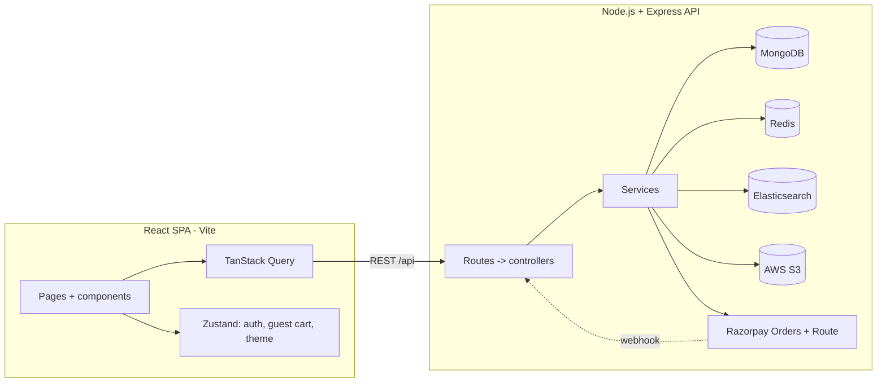
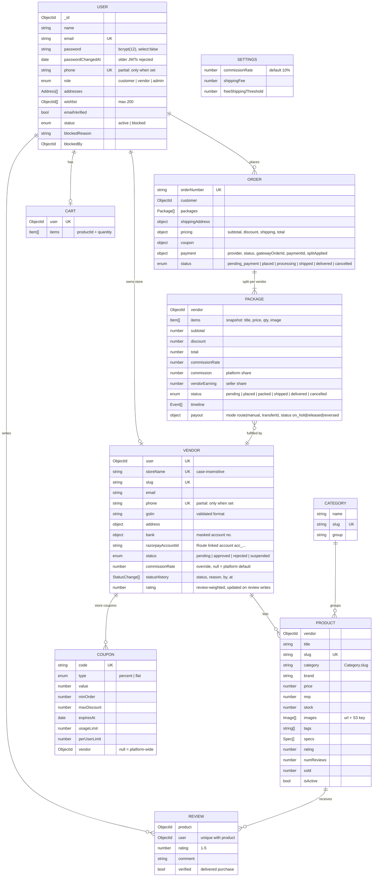
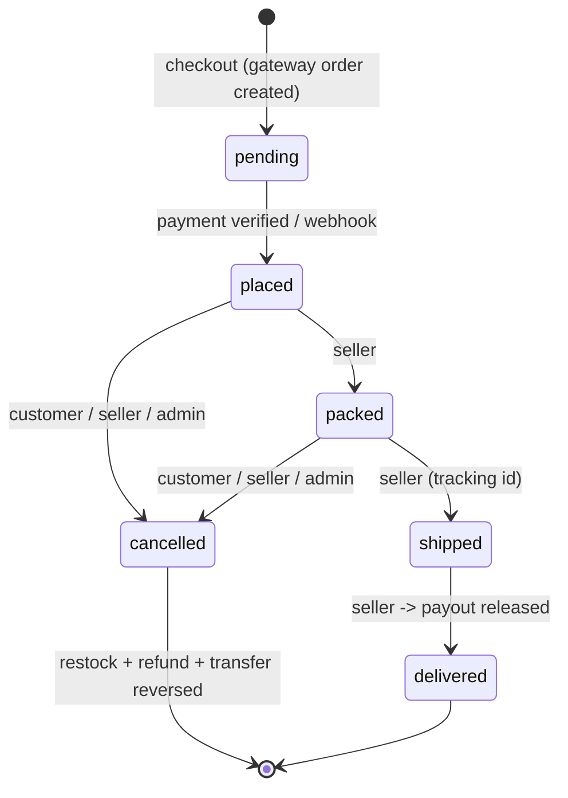
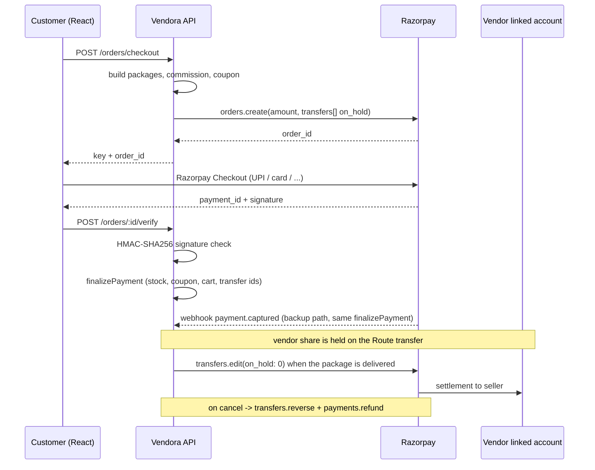

# Vendora: architecture, schema and API

This document covers step 1 of the brief: the roles, the database schema and the API list. It also describes the
order lifecycle and how payments are split between sellers and the platform.

## 1. Roles

| Role | Can do |
|---|---|
| **Customer** | Browse and search products, keep a Redis-backed cart, apply coupons, check out and pay, track packages, cancel before shipping, download PDF invoices, write reviews (verified when delivered), manage wishlist and addresses, apply to become a seller |
| **Vendor (seller)** | Onboard a store (business, address and bank details, optional Razorpay Route linked account), wait for approval, manage products with S3 image upload, fulfil packages (packed, shipped, delivered, or cancelled), create store coupons, see the earnings dashboard and payout ledger |
| **Admin** | Approve, reject or suspend sellers, set per-seller commission and Route account, moderate products, block users, manage any package, create platform coupons, change platform commission and shipping rules, view marketplace analytics, check service health and rebuild the search index |

Access is enforced on the server by `protect` (JWT plus a Redis session check) and `authorize(...roles)`. Seller routes
also require an **approved** store (`loadVendor`). On the client, `RequireAuth` guards each route group by role.

## 2. System overview

Each external service has an adapter in `server/src/services`. When a service isn't configured, the adapter falls back to
a local equivalent and logs which one it is using:

| Service | Adapter | Fallback |
|---|---|---|
| MongoDB | `config/db.js` | Embedded `mongod` from `pnpm db`, data saved in `server/.data` |
| Redis | `services/cache.js` | In-memory store with the same API; carts are still written through to MongoDB |
| Elasticsearch | `services/search.js` | MongoDB aggregation search with the same filters, facets and sorting |
| AWS S3 | `services/storage.js` | Files written to `server/uploads` and served at `/uploads` |
| Razorpay | `services/payment.js` | Built-in test gateway using the same order, verify and finalize flow |

## 3. Database schema (MongoDB)

Design notes:

- **An order is split into one package per vendor.** Each seller fulfils, tracks and gets paid for their own package
  independently. This is how Amazon-style marketplaces handle carts that contain items from several sellers.
- **Order items are snapshots** of the title, price and image, so editing or deleting a product never changes an old order.
- **Payment finalization is transactional.** On a replica set such as MongoDB Atlas, marking the order paid,
  decrementing stock, redeeming the coupon and emptying the cart commit in one multi-document transaction
  (`withTransaction` in `config/db.js`). Gateway calls happen before the transaction, and cache and search updates
  happen after it commits. On a standalone dev server the same steps run without a transaction, still guarded by the
  atomic `payment.status` claim.
- **Money is computed per package:** `total = subtotal - couponShare`, `commission = total × rate`,
  `vendorEarning = total - commission`. Platform coupons are shared across packages in proportion to their subtotals, and
  store coupons only discount that store's package.

## 4. Redis usage

| Key | Purpose | TTL |
|---|---|---|
| `cart:{userId}` | Cart lines (reads come from Redis; writes go to MongoDB as well) | 30 days |
| `user:{userId}` | Session profile cache used by `protect`, so authenticated requests don't hit MongoDB | 15 min |
| `revoked:{sid}` | Logged-out session ids; the JWT stops working immediately. Also stored in MongoDB (`revokedsessions`, TTL index on `expiresAt`) and reloaded into the cache on startup | until the token expires |
| `product:{idOrSlug}` | Product page payload (product, related items, store stats) | 5 min |
| `home:feed`, `categories`, `store:*` | Storefront listings | 2–10 min |
| `settings` | Commission and shipping rules | 5 min |

Writes invalidate the matching keys, for example when a product is updated, a review is posted or stock changes after payment.

## 5. Order lifecycle

The overall order status is derived from its packages (`Order.recomputeStatus`). For example, if one package has shipped
and another is still packed, the order shows as `shipped`.

## 6. Split payments (Razorpay Route)

If a seller has no linked account, or Route isn't enabled on the Razorpay account, the order is created without
`transfers`. The ledger still records each seller's share, and the platform settles it manually (payout mode `manual`).

## 7. Search (Elasticsearch)

- Index `vendora-products`. `title` uses the English analyzer, `titleSuggest` is a `search_as_you_type` field for the
  typeahead, `brand` and `category` are keyword fields for facets, and price, rating, stock, sold and discount are
  numeric fields for filters and sorting.
- Each query is a `multi_match` with fuzziness plus a phrase-prefix boost. Price, rating and stock go in the bool
  filter. Category and brand go in `post_filter`, so each facet still shows its other options. Aggregations return
  category and brand counts and the price range.
- Product create, update and delete, stock changes, reviews and store renames re-index the affected documents. On
  startup the index is rebuilt automatically if its document count differs from MongoDB. Admins can also run a full
  reindex.

## 8. API reference

Base URL is `/api`. Auth uses `Authorization: Bearer <jwt>`. Every error response has the shape `{ message, details? }`.

### Auth and account — `/api/auth`
| Method | Path | Access | Description |
|---|---|---|---|
| POST | `/register` | public | `{name,email,password,role: customer\|vendor}` → `{token,user}` |
| POST | `/login` | public | `{email,password}` → `{token,user}` (rate limited) |
| POST | `/logout` | auth | Revokes the session in Redis |
| GET | `/me` | auth | Profile, including the vendor profile for sellers |
| PATCH | `/me` | auth | Update name, phone and avatar |
| PUT | `/me/password` | auth | Change password |
| POST/PUT/DELETE | `/me/addresses[/:id]` | auth | Address book |
| GET | `/me/wishlist` | auth | Wishlist products |
| POST | `/me/wishlist/:productId` | auth | Toggle a wishlist item |

### Catalog — public
| Method | Path | Description |
|---|---|---|
| GET | `/home` | Storefront feed: categories, trending, deals, top rated, new arrivals, top stores |
| GET | `/categories` | Categories with product counts |
| GET | `/products` | Search: `q, category, brand (csv), minPrice, maxPrice, rating, inStock, vendor, sort, page, limit` → items, facets, engine |
| GET | `/products/suggest?q=` | Typeahead (products + categories) |
| GET | `/products/:idOrSlug` | Product detail + related products + store stats |
| GET | `/products/:id/reviews` | Paginated reviews, rating distribution, your review |
| POST | `/products/:id/reviews` | Create or update your review (customer) |
| GET | `/coupons?vendors=` | Active coupons a shopper can use |
| GET | `/stores`, `/stores/:slug` | Store directory, store profile and stats |
| POST | `/uploads?folder=` | Multipart `images[]` → S3 or local disk (auth) |

### Cart and orders — customers
| Method | Path | Description |
|---|---|---|
| GET | `/cart` | Cart with live prices, stock checks and summary |
| POST | `/cart/items` | Add `{productId, quantity}` |
| PATCH / DELETE | `/cart/items/:productId` | Change quantity / remove |
| POST | `/cart/merge` | Merge the guest cart after login |
| POST | `/cart/coupon` | Preview a coupon against the cart |
| POST | `/orders/checkout` | `{addressId \| address, couponCode}` → order + gateway config |
| POST | `/orders/:id/verify` | Verify the Razorpay signature (or test-gateway outcome) and finalize |
| GET | `/orders/:id/payment` | Retry payment for an unpaid order |
| GET | `/orders` | My orders |
| GET | `/orders/:id` | Order detail (customer: own orders; vendor: own packages; admin: any order) |
| GET | `/orders/:id/invoice` | PDF invoice |
| POST | `/orders/:id/cancel` | Cancel before shipping, with refund |
| POST | `/payments/webhook` | Razorpay webhook (raw body, HMAC verified) |

### Seller — `/api/vendor` (vendor role; approved store unless noted)
| Method | Path | Description |
|---|---|---|
| POST | `/onboard` | Submit a store application (customer or vendor) |
| GET / PUT | `/store` | View or edit the store (allowed while pending or rejected) |
| GET | `/dashboard` | KPIs vs the previous 30 days, daily series, payouts, top products, low stock |
| GET / POST | `/products` | List (search, status filter, sort) / create |
| GET / PUT / DELETE | `/products/:id` | Manage a product (re-indexes Elasticsearch) |
| GET | `/orders` | Packages with status counts |
| PATCH | `/orders/:orderId/status` | `{status, trackingId?, note?}`: packed, shipped, delivered or cancelled |
| GET | `/payouts` | Earnings ledger and summary |
| GET / POST / PUT / DELETE | `/coupons[/:id]` | Store coupons |

### Admin — `/api/admin`
| Method | Path | Description |
|---|---|---|
| GET | `/analytics?range=7\|30\|90\|365` | GMV, commission, orders, AOV with change vs the previous period, series, categories, top vendors and products |
| GET / PATCH | `/vendors[/:id]` | List and approve, reject, suspend; commission override; Route account |
| GET / PATCH | `/users[/:id]` | List and block or unblock (sessions are invalidated) |
| GET | `/orders` | All orders |
| PATCH | `/orders/:id/packages/:packageId` | Move a package through the lifecycle |
| GET / PATCH | `/products[/:id]` | Moderate the catalogue |
| GET / POST / PUT / DELETE | `/coupons[/:id]` | Platform coupons |
| GET / PUT | `/settings` | Commission rate, shipping fee, free-shipping threshold |
| GET | `/system` | Health of MongoDB, Redis, Elasticsearch, S3 and Razorpay |
| POST | `/search/reindex` | Rebuild the Elasticsearch index |
