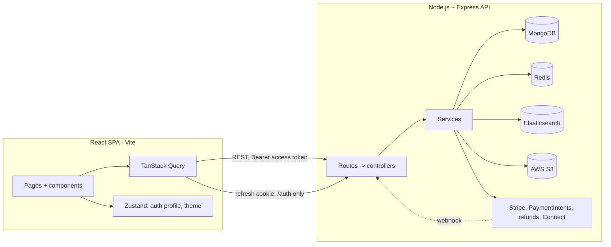
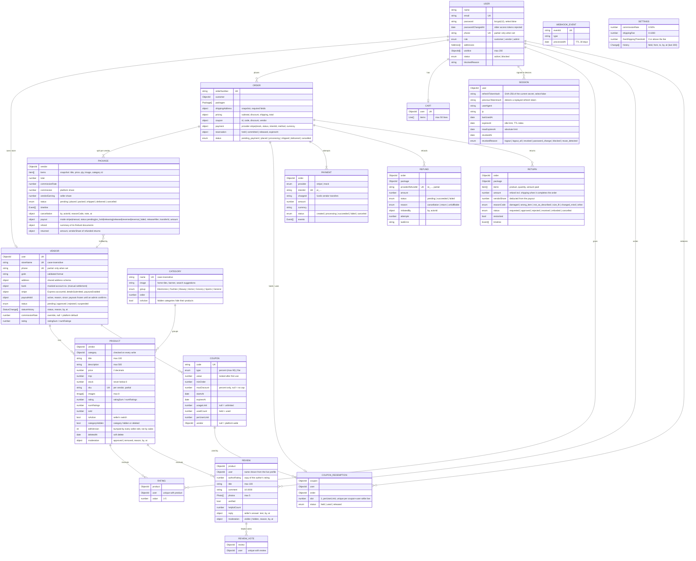
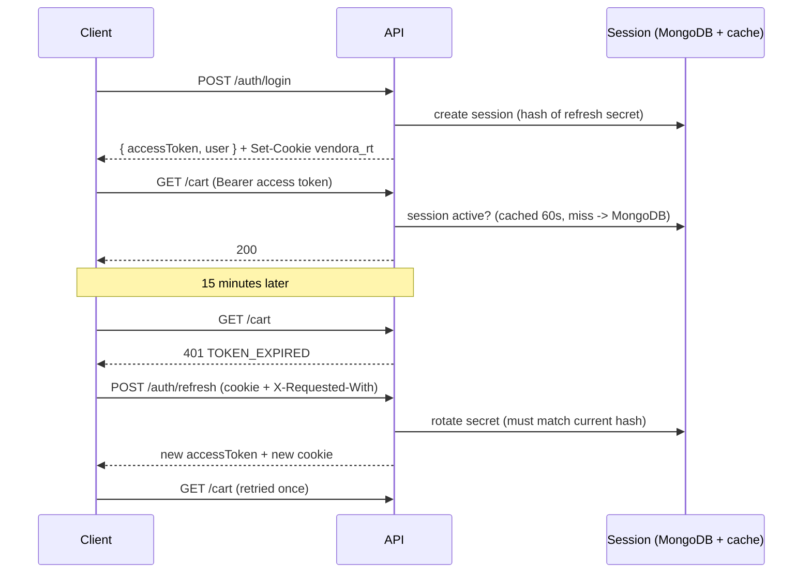
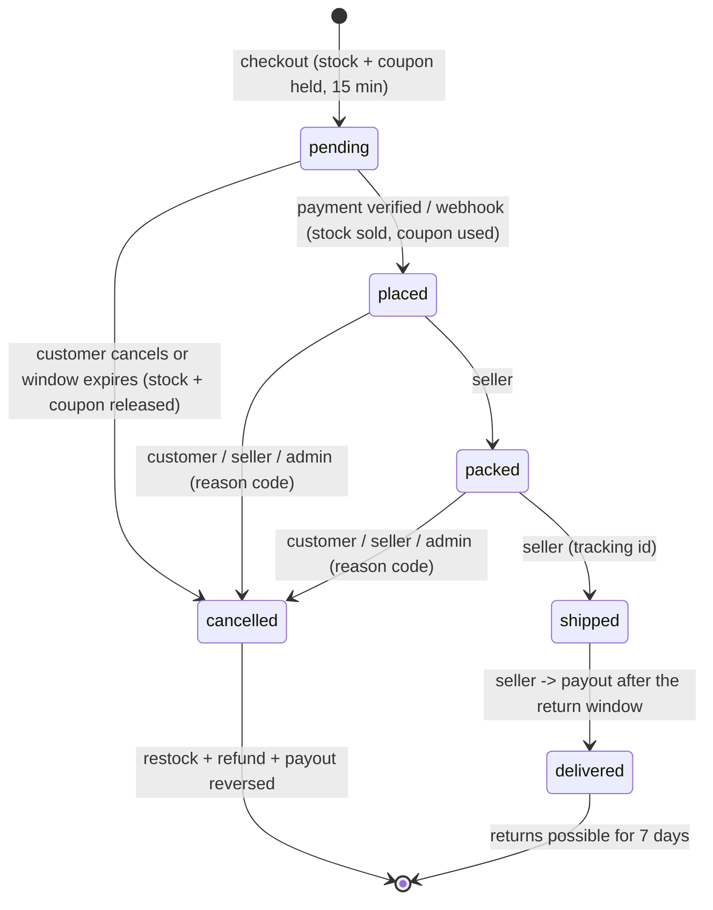
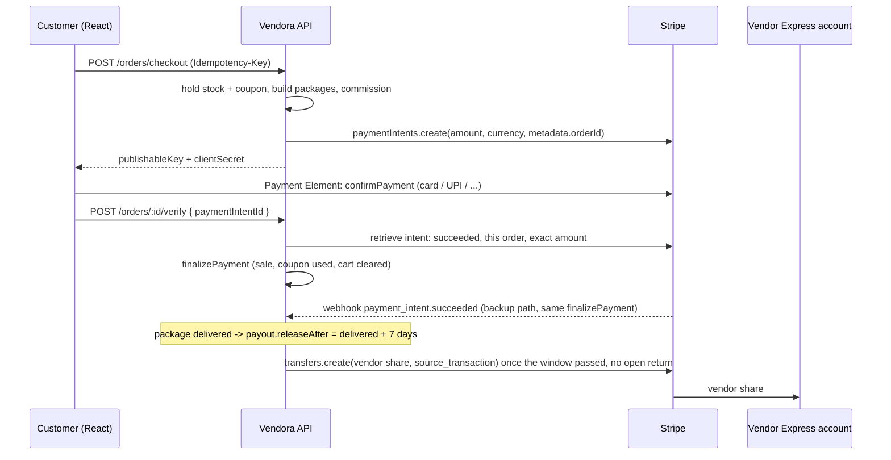

# Vendora: architecture, schema and API

This document covers the roles, the database schema and the API list. It also describes the order lifecycle, stock
reservation, authentication and how payments are split between sellers and the platform.

## 1. Roles

| Role | Can do |
|---|---|
| **Customer** | Browse and search products, keep a cart, apply coupons, check out and pay (Stripe), track packages, cancel a package or the whole order before shipping, return items within 7 days of delivery, download PDF invoices, rate and review products after delivery, vote reviews helpful, manage wishlist, addresses and signed-in devices, apply to become a seller |
| **Vendor (seller)** | Onboard a store (business, address and bank details), connect a Stripe Express account for payouts, wait for approval, manage products with image upload, fulfil packages (packed, shipped, delivered, or cancelled with a reason), approve and receive returns, reply to reviews, create store coupons, see the earnings dashboard and payout ledger |
| **Admin** | Approve, reject or suspend sellers (with a reason), set per-seller commission, confirm payout destination changes, retry refunds, run reconciliation, step in on returns, manage categories, moderate products and reviews, block users (ends their sessions), manage any package, create platform coupons, change platform commission and shipping rules (with a change history), view analytics, check service health and rebuild the search index |

Access is enforced on the server by `protect` (access token plus an active-session check) and `authorize(...roles)`.
Seller routes also require an **approved** store (`loadVendor`). On the client, `RequireAuth` guards each route group by role.

**Only customers buy.** Cart and checkout routes are customer-only on the server (403 otherwise), and the UI hides
every buying control from sellers and admins (`client/src/lib/roles.js`):

- Product cards show no **Add** button or quantity stepper; the product page shows, instead of *Add to cart / Buy now*,
  **Edit product** (a seller's own listing), **Moderate: remove / restore listing** (admin, with a reason) and a short
  note that buying is for customer accounts.
- `/cart` and `/sell` send sellers to the Seller Hub (or to their application status while the store is pending,
  rejected or suspended) and admins to the Admin console; `/checkout` already does via `RequireAuth`.
- "Become a seller" (home banner, the *Sell on Vendora* section, the footer *Sell* column) is shown only to guests
  and customers. A seller sees **Go to Seller Hub** or **View application status**, an admin **Open Admin console**.

## 2. System overview

Each external service has an adapter in `server/src/services`. When a service isn't configured, the adapter falls back to
a local equivalent and logs which one it is using:

| Service | Adapter | Fallback |
|---|---|---|
| MongoDB | `config/db.js` | Required (Atlas or any MongoDB). On a standalone server, payments use atomic single-document claims instead of transactions |
| Redis | `services/cache.js` | In-memory store with the same API (development only: production refuses to start without Redis unless `ALLOW_MEMORY_CACHE=true`) |
| Elasticsearch | `services/search.js` | MongoDB aggregation search with the same filters, facets and sorting |
| AWS S3 | `services/storage.js` | Files written to `server/uploads` and served at `/uploads` |
| Stripe | `services/payment.js` | Built-in test gateway using the same payment, verify and finalize flow |

Every URL uses ids (`/product/:productId`, `/store/:storeId`, `/search?category=<categoryId>`). There are no slugs.

## 3. Database schema (MongoDB)

Cart line: `{ product, quantity (1-10), priceAtAdd, addedAt }`.

Design notes:

- **An order is split into one package per vendor.** Each seller fulfils, tracks and gets paid for their own package.
- **Order items and the shipping address are snapshots**, so editing a product, category or saved address never changes an old order.
- **Stars and written reviews are separate.** One rating per customer per product, up to 20 reviews; both need a
  delivered order. Product and store averages are kept as running totals (`ratingSum`, `numRatings`) updated with one
  atomic update per rating change, never recounted on writes.
- **Limits are validated twice**: by the Mongoose schema and by the Zod request schemas, sharing the same constants
  (`PRODUCT_LIMITS`, `REVIEW_LIMITS`, `SETTINGS_LIMITS`, cart `MAX_PER_ITEM` / `MAX_LINES`).
- **Money is computed per package:** `total = subtotal - couponShare`, `commission = total × rate`,
  `vendorEarning = total - commission`. Platform coupons are shared across packages in proportion to their subtotals,
  store coupons only discount that store's package. The discount comes out of the package before commission, so the
  vendor bears it.
- **Hiding is preferred over deleting**: products are soft deleted, used coupons can only be deactivated, hidden
  reviews stay on record, and deleting a category hides its products until the seller picks a new one.

## 4. Concurrency rules

| What | How it stays correct |
|---|---|
| Stock | Checkout takes stock with `updateOne({ stock: { $gte: qty } }, { $inc: { stock: -qty } })` per line; a short line puts back the lines already taken. Two buyers can never get the last unit |
| Coupon limits | At checkout one redemption "slot" is created (unique index per coupon + user + slot) and `usedCount` is increased only while below `usageLimit` |
| Cart | Each write changes one line atomically (`$set` the line, `$push` with a "not already there, cart not full" filter, or `$pull`); reads never write quantities back |
| Ratings | `findOneAndUpdate` on the unique `{product, user}` returns the previous value; the difference is applied to the product and store totals in one pipeline update |
| Payment vs cancel | Both are single-document conditional updates on the same order (`payment.status` pending, not cancelled), so only one wins |
| Package updates | `withPackageLock` (cache lock per package) plus the allowed-transition check |
| Checkout retries | `Idempotency-Key` header: the same key returns the first response, no second order or PaymentIntent (Stripe idempotency key per order and attempt) |
| Refunds | Refund document first, Stripe idempotency key per attempt, and a lookup of earlier attempts before any retry: a refund is never paid twice |
| Vendor payouts | The job claims a package (`on_hold` → `releasing`) with a conditional update and looks for an earlier transfer before creating one |
| Returns | Each step (`requested` → `approved` → `received` → `refunded`) is one conditional update on the return's status |
| Webhooks | Unique `WebhookEvent.eventId`: a redelivered event is skipped |
| Order numbers | Unique index plus up to 5 retries on a collision, before the gateway is called |
| Refresh tokens | Rotation is one conditional update on the session (`refreshTokenHash` must match), so one request wins |
| Checkout (one per customer) | Lock `checkout:<userId>` for the whole checkout: a double click or a second tab gets 409 "A checkout is already in progress", never a second order |
| Checkout price | The client sends `expectedTotal` (what the customer saw). If prices, the delivery fee or the coupon changed, checkout answers 409 `CART_CHANGED` before any stock or coupon is held |
| Checkout stock / availability | A line capped by stock (`limited`) or a product that stopped being sold (`removed`) also answers 409 `CART_CHANGED` instead of silently ordering fewer items |
| Cart quantity clicks | The client sends one write per product at a time and only the latest wanted quantity next, so fast clicks can't arrive out of order |
| Seller product edits | Only changed fields are sent. Stock is written with `updateOne({ stock: stockBase })` (409 `STOCK_CHANGED` if sales moved it), and `editVersion` refuses a save from an outdated form (409 `PRODUCT_CHANGED`) |
| Reviews | Creation runs under a lock per customer + product (cap of 20 included); the same comment again within a minute is 409 |
| Store / user status (admin) | The status is changed with a conditional update on the status the admin saw; a second admin acting at the same moment gets 409 |
| Store taken offline | Suspending a store or blocking its owner with paid, unshipped packages needs `openOrders: cancel \| keep` (409 `OPEN_ORDERS` otherwise); `cancel` cancels and refunds each package under its package lock |
| Category deleted during a product save | After saving, the product checks its category still exists and is hidden like the category's other products if not |

### Live updates (change streams + Server-Sent Events)

An open cart must not show stale stock, prices or coupons. `services/productEvents.js` watches MongoDB change streams
(they need a replica set; Atlas is one):

| Watched | Trigger | Effect |
|---|---|---|
| `products` | `stock`, `price`, `mrp`, `isActive`, `deletedAt`, `moderation` changed (any writer: seller edit, another order reserving stock, cancel/restock, admin) | The cached product page (`product:<id>`) is dropped, and `change` is emitted |
| `vendors` | `status` changed (suspended, approved) | Every product of the store counts as changed |
| `coupons` | Any update or delete | `coupon` is emitted |

`GET /cart/events` (customers) is a Server-Sent Events stream, at most 5 open per user (the 6th gets 429). It sends
`cart` when a changed product is in **this** customer's cart and `coupon` (no id, so private coupons stay hidden) on
any coupon change, with a ping every 25 s; `Cache-Control: no-transform` keeps
compression from buffering it. The client (`useCartLiveUpdates`, read with `fetch` so the Bearer token is sent)
refetches the cart and that product page, reloads coupon offers and re-checks the applied coupon (removing it with a
notice when it no longer applies). It reconnects with backoff and a fresh access token. As a fallback the cart,
product page and coupon box also refetch on open and on window focus. On a standalone MongoDB the stream is off and
only the fallback and the checkout checks apply.

## 5. Authentication and sessions

| Token | Lifetime | Stored |
|---|---|---|
| Access token (JWT `{ sub, role, sid }`) | 15 min (`ACCESS_TOKEN_TTL`) | Client memory only; sent as `Authorization: Bearer` |
| Refresh token `<sessionId>.<secret>` | 30 days idle (`REFRESH_IDLE_DAYS`), 90 days max (`SESSION_MAX_DAYS`) | httpOnly cookie `vendora_rt`, path `/auth`; only its SHA-256 is in MongoDB |

- **Allowlist:** a request is accepted only while its session exists and isn't revoked. A missing cache entry means
  "check MongoDB", never "let it through".
- **Rotation:** every refresh replaces the refresh token. The previous one is still accepted for 30 seconds (two tabs
  refreshing at once) without issuing a new cookie. Used again later, it counts as stolen and the whole session is revoked.
- **The client** keeps the access token in memory and only the profile in localStorage. One refresh runs at a time;
  requests that get `TOKEN_EXPIRED` wait for it and retry once. On a page reload the first request refreshes first.
  Any other 401 (`SESSION_ENDED`, `INVALID_TOKEN`, `NO_SESSION`) signs the user out: the profile and every cached
  query are dropped and the app goes to the home page, signed out, with "Your session has expired". A deliberate
  logout skips the message. A 503 (database unreachable) never signs anyone out.
- **Opening the site with a saved profile** (no access token in memory yet) shows a loading screen until
  `/auth/refresh` answers, so an expired session lands straight on the signed-out home page (even from `/account`,
  `/vendor` or `/admin`) with no flash of the signed-in site. If the API can't be reached, the saved profile is kept.
- **Profile reloads** (`refreshMe`) share one in-flight `GET /auth/me`; callers after a save pass `fresh` to get a
  new answer.
- **Revocation:** logout (this device, works from the cookie even after the access token expired), log out of one
  device, log out of all devices, password change (all other devices; this one gets a new session), admin block (all).
- **Blocked accounts:** blocking revokes every session, and from then on the account gets `403 ACCOUNT_BLOCKED`
  (with the admin's reason), never a sign-out 401. `blockedGuard` runs before every route, public catalog included,
  and refuses any request carrying the blocked account's Bearer token (expired ones too: the check only denies).
  `protect` and `/auth/refresh` answer `ACCOUNT_BLOCKED` for a session the block ended. They read the session and
  user from MongoDB, so a profile re-cached by a request racing the block can't turn it into `SESSION_ENDED`. So
  does `/auth/login`. That answer also sets `vendora_blocked`, a signed httpOnly cookie on `/` (30 days). While the
  account is still blocked, the guard refuses that browser on **every** request, signed out and register included;
  only `POST /auth/login` and `/auth/logout` pass. The cookie is dropped when an admin unblocks the account (next
  request) or when an account that isn't blocked signs in there.
- **Taking effect without a reload:** pages can render from the query cache without calling the API, so the
  client calls `GET /auth/status` on every page change (at most once per 2 s), when the tab regains focus and every
  minute. The first `ACCOUNT_BLOCKED` replaces the whole app with the blocked screen, on every URL. Only a 401 or a
  new token from its "Check again" lifts it.
- **CSRF:** the refresh cookie only goes to `/auth`, and `/auth/refresh` requires `X-Requested-With: vendora`,
  which another site can't send without passing CORS. Set `COOKIE_SAMESITE=none` (HTTPS) when the API is on another domain.

## 6. Cache (Redis or in-memory)

| Key | Purpose | TTL |
|---|---|---|
| `cart:{userId}` | Raw cart lines. Cache-aside: writes change MongoDB and delete the key | 10 min |
| `user:{userId}` | Profile used by `protect` | 15 min |
| `session:{sid}` | "This session is active" (deleted on revoke) | 60 s |
| `product:{id}` | Product page payload (product, related items, store stats) | 5 min |
| `home:feed`, `categories`, `store:{id}`, `vendors:approved` | Storefront listings | 2–10 min |
| `settings` | Commission and shipping rules | 5 min |
| `idem:checkout:{user}:{key}:result` | Checkout idempotency: the first response, returned to retries | 24 h |
| `lock:checkout:{user}:{key}` | One checkout per Idempotency-Key at a time | 60 s |
| `lock:package:{id}` | One package write at a time (status changes, return requests, the payout claim) | 30 s |
| `lock:refund:{id}` | One retry per refund at a time | 60 s |
| `lock:search:reindex` | One Elasticsearch rebuild at a time across instances | 10 min |
| `rl:{auth\|refresh\|password}:{ip}` | Login/register, refresh and password-change rate limits | 15 min window |
| `rl:upload:{user}` | Image uploads per account | 15 min window |

Writes invalidate the matching keys, for example when a product, rating, category or setting changes.

**Locks** (`services/locks.js`) are `SET key <random token> NX EX <ttl>`: taken and given an expiry in one
command, so a crashed holder can't block a package forever, and released by a Lua script that deletes the key
only if it still holds the caller's token. **Rate limits** use one Lua script (`INCR` + `PEXPIRE` on the first
hit) through `services/rateLimitStore.js`, so every API instance shares the same counters. The global
600-requests-per-minute flood guard stays per instance, to spare Redis a command on every request.

**When Redis is down** the failure policy depends on what the key protects:

| Use | Behaviour |
|---|---|
| Caches, cart, `user:*`, `session:*` | Treated as a miss: read from MongoDB (sessions are checked in MongoDB, so revocation still holds) |
| Locks | Refused with 503 `LOCK_UNAVAILABLE`: a lock that can't be checked is never granted. The payout job skips the package until the next run |
| Rate limits | Counted in the process until Redis is back, so limits still apply per instance |
| Startup | Development falls back to memory with a warning; production refuses to start |

A new refund is sent without a lock (nobody else knows its id yet, and the Stripe idempotency key covers a racing
retry), so an outage can't leave a cancellation half done.

## 7. Order lifecycle and stock reservation

- **Reservation:** checkout holds the stock before the order is saved (409 before paying if it ran out). A sweeper
  runs every minute and cancels unpaid orders whose window (`STOCK_RESERVATION_MINUTES`, default 15) has passed, using
  the `{ reservation.status, reservation.expiresAt }` index. A payment that arrives after that, or when stock is short,
  is refunded automatically.
- **Coupons:** a held coupon use is released when an unpaid order is cancelled or expires. Once an order is paid, the
  use is permanent, even if the order is later cancelled or refunded.
- **Cancellation record:** each cancelled package stores `cancellation { by: customer|vendor|admin|system, actorId,
  reasonCode, note, at }`. Reason codes per actor: customer `changed_mind, other`; vendor `out_of_stock,
  vendor_unable, other`; admin adds `fraud`; the system sets `payment_timeout, payment_after_cancel, out_of_stock`.
  `other` needs a note.
- The overall order status is derived from its packages (`Order.recomputeStatus`).

## 8. Payments, refunds and payouts (Stripe)

The platform uses Stripe **separate charges and transfers**: the customer pays the platform once for the whole order,
and each vendor share is transferred to the vendor's Stripe Connect (Express) account later, after delivery and the
return window.

- **Payment attempts:** each PaymentIntent is a `Payment` document (`created`, `processing`, `succeeded`, `failed`,
  `canceled`) with an event history. Retrying payment reuses the intent while it can still be paid and opens a new
  attempt otherwise. The order keeps a summary (`payment.provider | status | intentId | method | currency`).
- **Capture check:** before an order is marked paid (checkout callback, webhook or reconciliation), the intent is fetched
  from Stripe and must carry this order id, be exactly the order total in the order currency, and have `succeeded`. An
  intent waiting for manual capture is captured by the API; any other status is rejected.
- **Refunds:** every refund (cancelled package, return, unfulfillable order) is a `Refund` document written **before**
  Stripe is called. Its id goes into the Stripe metadata and the idempotency key. A retry (admin, `POST
  /admin/refunds/:id/retry`) first asks Stripe whether an earlier attempt already went through and adopts it, so a
  refund is never paid twice. Package summaries (`packages.refund`) and `payment.status` are derived from the Refund
  documents; one failed refund never overwrites another package's successful one.
- **Payouts:** `pending` (unpaid) → `on_hold` (paid) → `releasing` (claimed by the hourly job) → `released`; or
  `reversed` when the package is cancelled (nothing had been transferred yet). The job pays `vendorEarning` minus the
  vendor share of refunded returns, only after `delivered + RETURN_WINDOW_DAYS`, never while a return is open or the
  vendor is on a payout hold. A transfer is funded by the order charge (`source_transaction`) and looked up by package
  before it is created, so a retry can't pay twice. Vendors without a ready Stripe account are settled manually
  (`mode: manual`). A released transfer that must be pulled back is marked `reversed` only when Stripe confirms it,
  otherwise `reversal_failed`.
- **Payout destination (protected):** connecting or replacing the Stripe account, or changing manual bank details, needs
  the account password and is recorded in `payoutChanges`. If money is still waiting to be paid out, the vendor gets a
  `payoutHold` until an admin confirms the change (`PATCH /admin/vendors/:id/payout-hold`). A bank account changed
  inside Stripe (`account.external_account.*` webhook) freezes payouts the same way. Payouts only go to accounts Stripe
  reports as `payouts_enabled`.
- **Webhooks:** `POST /payments/webhook` verifies the `Stripe-Signature` header (account and Connect endpoint secrets).
  Each event id is stored in `WebhookEvent` (unique) so a redelivery is skipped; a handler error returns 500 and Stripe
  retries. Handled: `payment_intent.succeeded | processing | payment_failed | canceled`, `refund.created | updated |
  failed`, `charge.refund.updated`, `account.updated`, `account.external_account.created | updated | deleted`.
- **Reconciliation** (every 6 hours, or `POST /admin/payments/reconcile`): finalizes intents that succeeded without us
  hearing about it, syncs pending or failed refunds with Stripe (adopting refunds that went through), and resets payout
  claims abandoned mid-transfer. What it can't fix appears in the admin exceptions and the Payments page.
- **Test gateway:** without Stripe keys the same flow runs on a built-in gateway. In production the API refuses to start
  without keys, and `/verify` refuses simulated payments, unless `ALLOW_TEST_GATEWAY=true` (demo deployments only).

### Returns

A customer can return items of a delivered package within `RETURN_WINDOW_DAYS` (default 7) of delivery:
`requested` → `approved` (vendor; the admin can act too) → `received` (vendor inspected it, optionally restocking) →
`refunded`; or `rejected` / `cancelled` (withdrawn). The refund is exactly what was paid for the returned units (their
share of the coupon taken off); shipping comes back only when the return completes the whole package and no other
package of the order is live. The vendor share of the refund is deducted from the package payout. Each step is an
atomic status change, so a double click can't apply it twice.

## 9. Search (Elasticsearch)

- **Alias and builds.** Searches and writes use the alias `vendora-products`, which points at one built index
  (`vendora-products-v{version}-{timestamp}-{random}`). A rebuild fills a new index next to the live one and then moves the
  alias in one atomic `updateAliases` call, so search never sees an empty or half-built index. Products changed
  while it was filling are written again after the switch. One rebuild runs at a time (Redis lock
  `lock:search:reindex`; a second one gets 409).
- **When it rebuilds.** On startup when there is no index, when `INDEX_VERSION` in `services/search.js` changed (bump
  it whenever the settings or mappings change), or when the document count differs from MongoDB; after an outage;
  and from Admin → Settings → Reindex.
- **Mapping** (`dynamic: strict`). Title, brand, category name, tags, specs and store name are copied into
  `searchText`. Text uses a light English stemmer with ASCII folding; at search time a synonym filter adds Indian
  shopping synonyms (phone/mobile/smartphone, tv/television, tshirt/tee, ac/air conditioner, ...). `titleSuggest` is
  a `search_as_you_type` field for the typeahead, `brand` and `category` (the id) are keywords for facets, and price,
  rating, stock, sold and discount are numeric fields for filters and sorting. Deleted and hidden products stay in
  the index with `isActive: false`; a product is active only when it is listed and its store is approved (the same
  rule as the MongoDB search).
- **Query.** Every typed word must match `searchText` (fuzzy, so typos work), and phrase, title, brand and category
  matches rank higher. If no product has every word and the query has several words, it is run again with any word
  matching (description included) and the response has `relaxed: true`, which the search page explains. Price,
  rating and stock go in the bool filter; category and brand go in `post_filter`, so each facet still shows its other
  options. `createdAt` breaks sort ties, so pages never swap products.
- **Every search box uses it.** Besides the shop's product search, `services/entitySearch.js` keeps two more
  indices: `<alias>-vendors` (store name, tagline, email, phone, GSTIN, city/state, owner name and email) and
  `<alias>-users` (name, email, phone). The shoppers' store search matches only what a store page shows (name,
  tagline, city/state), so nobody can probe which store an email or phone belongs to; admin search uses every field.
  Store search, admin vendors, admin users and the admin order search (by
  customer, store or product name) query them, and the seller's and admin's product lists query the product index
  (hidden and deleted products included, a seller only sees their own). Matching is typo tolerant (`fuzziness:
  AUTO`), half-typed names match by prefix, and an exact email, phone or GSTIN ranks first. Elasticsearch returns
  ids best-first; MongoDB applies the page's filters and keeps that order (`pageByRank`). Both indices are built on
  startup when missing or out of step, rebuilt after an outage, and kept current by change streams on `vendors` and
  `users`. Without Elasticsearch every list falls back to its MongoDB text match.
- **Sorts.** `popular` (default), `price_asc`, `price_desc`, `rating`, `newest`, `discount`. With search text,
  `popular` ranks best matches first and then units sold; without it, best-sellers first. Any other value
  (including the old `relevance`) falls back to `popular`.
- **Outages.** Requests time out after 5 s. A connection error moves search to MongoDB at once (no request waits
  on a dead Elasticsearch), index writes are skipped, and the API checks every 15 s. Once it answers, the index is
  rebuilt from MongoDB and search switches back. `/health` shows `mongodb (elasticsearch reconnecting)` meanwhile.
- Without Elasticsearch, MongoDB search matches typed words against category **names** (never ids) as well as title,
  brand, tags and description.
- `pnpm --dir server es:check` runs the real queries (typos, synonyms, facets, typeahead) against sample products in
  a temporary index, then reports the live index.
- **Did you mean.** The typeahead request also runs a phrase suggester on `spell` (title, brand, category and tags,
  unstemmed, with 2–3 word shingles). A correction is returned as `didYouMean` only when it finds at least one
  active product (collate query) and changes a word rather than completing the one being typed ("gala" -> "galaxy"
  is left to the product suggestions). The search bar shows it first, with the corrected words in bold.

## 10. API reference

Base URL is the API origin (e.g. `http://localhost:5050`, no `/api` prefix). In development the client calls the same paths on its own origin (`http://localhost:5180/auth/me`) and the Vite proxy forwards them; page loads (`Accept: text/html`) of paths shared with the app, like `/cart` or `/admin/orders`, get the app instead. Auth uses `Authorization: Bearer <accessToken>`. Every error response has the shape
`{ message, details? }`; auth errors carry `details.code`. When MongoDB can't be reached (network drop, Atlas
election) a request waits at most 10 s (`serverSelectionTimeoutMS`) and gets `503 { details: { code: "DB_UNAVAILABLE" } }`
with `Retry-After: 5`; the log gets one line per request and a single "connection lost / restored" pair.

### Auth and account — `/auth`
| Method | Path | Access | Description |
|---|---|---|---|
| POST | `/register` | public | `{name, email, password, role: customer\|vendor}` → `{accessToken, user}` + refresh cookie |
| POST | `/login` | public | `{email, password}` → `{accessToken, user}` + refresh cookie (rate limited) |
| POST | `/refresh` | refresh cookie | Header `X-Requested-With: vendora` → `{accessToken, user}` + rotated cookie |
| POST | `/logout` | cookie or auth | Ends this device's session and clears the cookie |
| POST | `/logout-all` | auth | Ends every session of the account |
| GET | `/sessions` | auth | Signed-in devices (`current` marks this one) |
| DELETE | `/sessions/:id` | auth | Log out one device |
| GET | `/status` | auth | `{ ok: true }` while the session stands; the client's per-page check (401 / 403 `ACCOUNT_BLOCKED` otherwise) |
| GET | `/status` | auth | `{ ok: true }`: cheap "is my session still valid?" check (token, active session, not blocked). The client calls it on page changes, tab focus and every 60 s, so a block, logout elsewhere or expired session takes effect on the next click |
| GET / PATCH | `/me` | auth | Profile (including the store for sellers) / update name, phone, avatar |
| PATCH | `/me/password` | auth | Change password → `{accessToken}`; other devices are logged out |
| GET / POST | `/me/addresses` | auth | Address book |
| PATCH / DELETE | `/me/addresses/:addressId` | auth | Edit / remove an address |
| GET | `/me/wishlist` | auth | Wishlist products |
| PUT / DELETE | `/me/wishlist/:productId` | auth | Add / remove (max 200) |

### Catalog — public unless noted
| Method | Path | Description |
|---|---|---|
| GET | `/home` | Storefront feed: categories, trending, deals, top rated, new arrivals, top stores |
| GET | `/categories` | Visible categories with product counts |
| GET | `/products` | Search: `q, category (id), brand (csv), minPrice, maxPrice, rating, inStock, vendor, sort, page, limit` → items, facets, engine |
| GET | `/products/suggest?q=` | Typeahead (products + categories) |
| GET | `/products/:productId` | Product detail + related products + store stats |
| PUT / DELETE | `/products/:productId/rating` | Set `{value: 1-5}` / remove your rating (auth, delivered order) |
| GET | `/products/:productId/reviews` | Visible reviews (`sort=recent\|top\|low\|helpful`, `rating`), star distribution, your rating, votes and what you may do |
| POST | `/products/:productId/reviews` | `{title, comment, photos[]}` (auth, delivered order, max 20; the same comment again within a minute is 409) |
| PATCH / DELETE | `/products/:productId/reviews/:reviewId` | Edit / delete your review (admins may delete) |
| POST / DELETE | `/products/:productId/reviews/:reviewId/helpful` | Vote / unvote helpful (auth, not your own) |
| GET | `/coupons?vendors=` | Active, started coupons a shopper can use |
| GET | `/stores`, `/stores/:storeId` | Store directory, store profile and stats |
| POST | `/uploads?folder=products\|stores\|avatars\|reviews\|returns` | Multipart `images[]` → S3 or local disk (auth) |

**Uploads.** Up to 8 images of 5 MB per request and 60 requests per 15 minutes per account. Each file's type is
read from its first bytes (JPG, PNG, WEBP, GIF, AVIF), so a renamed page or script is refused. Files are stored
as `{folder}/{YYYY-MM-DD}/{uploader's user id}/{uuid}.{ext}`. Product, review, return, avatar and store image
fields take plain URLs: the server works out the key from the URL and, after the change is saved, deletes a
replaced image only when the same user uploaded it. Seeded and external images are never deleted.

### Cart and orders — customers
| Method | Path | Description |
|---|---|---|
| GET | `/cart` | Cart with live prices, `requestedQuantity` / `limited` when stock is short, `priceChanged`, `removed` (lines dropped on this read because the product stopped being sold, reported once), summary |
| GET | `/cart/events` | Server-Sent Events: `ready`, then `cart` (a product in your cart changed) and `coupon` (a coupon changed). At most 5 per user (429) |
| POST | `/cart/items` | `{productId, quantity}` sets the line's total quantity (adds it if missing) |
| DELETE | `/cart/items/:productId` | Remove a line |
| DELETE | `/cart` | Empty the cart |
| POST | `/cart/coupon` | Preview a coupon against the cart |
| POST | `/orders/checkout` | Header `Idempotency-Key`; `{addressId \| address, couponCode, expectedTotal?}` → order + gateway config. 409 `CART_CHANGED` (total, stock or availability changed) or "already in progress" (another checkout running) |
| POST | `/orders/:id/verify` | `{paymentIntentId}` (or test-gateway `outcome`): checked with Stripe, then the order is finalized |
| GET | `/orders/:id/payment` | Payment form for an unpaid order (reuses or reopens the PaymentIntent) |
| GET | `/orders` | My orders |
| GET | `/orders/:id` | Order detail (own orders only), plus `refunds[{storeName, amount, status, reason, createdAt}]` |
| GET | `/orders/:id/invoice` | PDF invoice |
| POST | `/orders/:id/cancel` | `{packageIds?, reasonCode?, note?}`: cancel chosen packages (default all) before shipping, each refunded on its own |
| GET / POST | `/orders/:id/returns` | Returns of the order / request one `{packageId, items[{product, quantity}], reasonCode, note?, photos?}` |
| GET | `/returns` | My returns |
| POST | `/returns/:returnId/cancel` | Withdraw a requested return |
| POST | `/payments/webhook` | Stripe webhook (raw body, `Stripe-Signature` verified, deduplicated) |

### Seller — `/vendor` (vendor role; approved store unless noted)
| Method | Path | Description |
|---|---|---|
| POST | `/onboard` | Submit a store application (customer or vendor) |
| GET / PATCH | `/store` | View or edit the store (allowed while pending or rejected) |
| GET | `/dashboard` | KPIs vs the previous 30 days, daily series, payouts, top products, low stock |
| GET / POST | `/products` | List (search, status filter, sort) / create |
| GET / PATCH / DELETE | `/products/:id` | Manage a product (delete is a soft delete). PATCH takes only changed fields plus `editVersion` and, when stock changes, `stockBase`: 409 `PRODUCT_CHANGED` / `STOCK_CHANGED` |
| GET | `/orders` | Packages with status counts |
| PATCH | `/orders/:orderId/status` | `{status, trackingId?, note?, reasonCode?}`: packed, shipped, delivered or cancelled (reason code required) |
| GET | `/payouts` | Earnings ledger, summary, Stripe status, payout hold |
| GET | `/stripe` | Stripe Connect status (refreshed from Stripe; allowed while pending) |
| POST | `/stripe/onboarding` | Create the Express account (password on an approved store) and get the onboarding link |
| POST | `/stripe/replace` | `{currentPassword}`: switch to another Stripe account; waiting payouts are frozen |
| POST | `/stripe/dashboard` | Link to the vendor's Stripe Express dashboard |
| GET | `/returns?status=` | Returns of your packages |
| PATCH | `/returns/:returnId` | `{action: approve\|reject, note}` (reject needs a note) |
| POST | `/returns/:returnId/receive` | `{restock, note?}`: item inspected, customer refunded |
| GET | `/reviews?replied=yes\|no` | Reviews on your products |
| PUT / DELETE | `/reviews/:id/reply` | Post or edit / remove your public reply |
| GET / POST | `/coupons` | Store coupons |
| PATCH / DELETE | `/coupons/:id` | Edit / delete (used coupons can only be deactivated) |

### Admin — `/admin`
| Method | Path | Description |
|---|---|---|
| GET | `/analytics?range=7\|30\|90\|365` | GMV, commission, orders, AOV with change vs the previous period, series, categories, top vendors and products |
| GET / PATCH | `/vendors[/:id]` | List (`?payoutHold=1` for frozen payouts) and approve, reject, suspend (reason required); commission override. Suspending a store with paid, unshipped packages needs `openOrders: cancel \| keep` (409 `OPEN_ORDERS`) |
| PATCH | `/vendors/:id/payout-hold` | `{action: release\|hold, reason?}`: confirm a payout destination change, or freeze payouts |
| GET / PATCH | `/users[/:id]` | List and block (reason required, sessions ended, the user's browser gets only `ACCOUNT_BLOCKED`) or unblock. Blocking a seller suspends the store, so the same `openOrders` choice applies |
| GET | `/orders`, `/orders/summary`, `/orders/export` | All orders with filters, KPIs and exceptions, CSV export |
| GET | `/orders/:id`, `/orders/:id/invoice` | Any order and its invoice |
| PATCH | `/orders/:id/packages/:packageId` | Move a package through the lifecycle (cancel needs a reason code) |
| GET / PATCH | `/products[/:id]` | Catalogue and moderation (`approved \| removed` with a reason) |
| GET / PATCH | `/reviews[/:id]` | Moderation queue; hide (reason required) or show a review |
| GET / POST | `/categories` | All categories with product counts / create |
| PATCH / DELETE | `/categories/:id` | Rename, regroup, reorder, change image, hide or show / delete |
| GET / POST | `/coupons` | Platform coupons |
| PATCH / DELETE | `/coupons/:id` | Edit / delete (used coupons can only be deactivated) |
| GET / PATCH | `/settings` | Commission rate, shipping fee, free-shipping threshold, plus the latest 20 changes |
| GET / POST | `/refunds?status=`, `/refunds/:id/retry` | Refunds by status (default failed) / safe retry |
| GET / PATCH / POST | `/returns`, `/returns/:returnId`, `/returns/:returnId/receive`, `/returns/:returnId/refund` | Oversee returns and take any step; retry a return's refund |
| POST | `/payments/reconcile` | Compare Stripe with the database and repair what is safe |
| POST | `/payouts/release` | Run the payout job now |
| GET | `/system` | Health of MongoDB, Redis, Elasticsearch, S3 and Stripe |
| POST | `/search/reindex` | Rebuild the Elasticsearch index |

`GET /health` reports which services are live.
